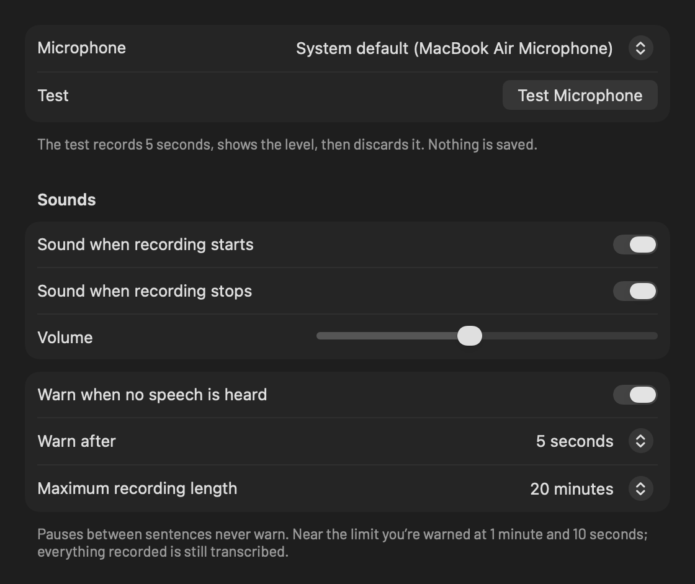

# Stage 1 test report: recording and microphone

Date: 2026-11-22, 20:13–20:27.
- Mac: MacBook Air M4, 16 GB, macOS 26.5.2.
- App: `/Applications/EsyType.app` 0.1.0, release, signed "EsyType Dev". Model: Whisper Small Q8_0.

## How the tests were run

- **Real app, real microphone, synthetic voice.** Sentences were spoken by macOS `say` (voice Samantha)
  through the MacBook speakers and recorded by the microphone.
- **Shortcuts** were sent as system-level (HID) key events, the same path as the keyboard.
- **Results were read back** from the app log (stages only, never text), from TextEdit and Safari through
  Accessibility, and from the history database when a result was unexpected.
- **Two runs were disturbed by people using the Mac.** TextEdit's document was closed, the volume changed, and
  room conversation was recorded in the 75 s run. Those runs were repeated. None of the results below rely on a
  disturbed run.
- Statuses: **PASS** (real run on this Mac), **FAIL**, **NOT TESTED**. "Simulated" marks unit tests with made-up input.

## Devices on this Mac

| Device | UID | Notes |
|---|---|---|
| MacBook Air Microphone (default) | `BuiltInMicrophoneDevice` | 48 kHz, 1 ch |
| Nikita’s iPhone Microphone | Continuity | Not tested: it would wake the iPhone |
| Microsoft Teams Audio | `MSLoopbackDriverDevice_UID` | Virtual loopback, delivers exact zeros |

No USB or Bluetooth microphone was attached.

## Features and results

### 1. Recording sounds

| Test | Result | Evidence |
|---|---|---|
| Start sound plays only once audio really arrives | PASS | 10+ runs. "Microphone live after 188–240 ms", then "Start sound played" 20–80 ms later. |
| Stop sound when recording stops (toggle, hold release, limit) | PASS | "Stop sound played" in every run |
| No stop sound without a start sound (very short hold) | PASS (by design) | The stop sound needs `captureLive` |
| Start sound off: no effect on the transcript | PASS | Identical output ×2 with it on and off |
| Separate toggles and volume | PASS (setting read per run) | Volume slider plays a preview. **Audible check not done:** I can't hear the speakers. |
| Sounds exist on this Mac | PASS | `recordingSoundsExistOnThisMac` (Tink, Pop) |

### 2. Microphone selection

| Test | Result | Evidence |
|---|---|---|
| List microphones | PASS | `listsThisMacsMicrophones` (Real device): 3 devices, unique UIDs, default included |
| Choose a specific mic (built-in, by UID) | PASS | Log "input MacBook Air Microphone". Text typed. |
| Choose a different device (Teams Audio) | PASS | Log "input Microsoft Teams Audio, 48000.0 Hz, 1 ch" |
| Chosen mic not connected | PASS | Log "chosen microphone missing", recorded from the default, text typed. The pill shows "Mic missing. Using default" for 4 s (not seen on screen). |
| System default changes mid-recording | PASS | Default switched to Teams Audio and back during one recording. It kept recording, and the sentence after the switches was typed. Default input restored afterwards. |
| Choice logic | PASS (Simulated) | `resolvesTheChosenMicrophoneOrFallsBack` |
| List refreshes on plug/unplug | NOT TESTED physically | `AudioInputWatcher` listens for Core Audio device and default changes |
| Physical unplug of a USB/Bluetooth mic mid-recording | NOT TESTED | No such device attached. The code path is the same configuration-change restart as the default switch above. |

### 3. No-speech detection

| Test | Result | Evidence |
|---|---|---|
| Silent room, 7 s | PASS | "Recording notice: noSpeech" at 4.92–5.0 s. Recording continued until stopped. |
| Speech, 7 s pause, speech | PASS | No notice. Both sentences typed. |
| Exact-zero device (Teams Audio) | PASS | "noSignal" at 5.0 s (loudest −inf dBFS): told apart from silence |
| Mic stops delivering audio | PASS (Simulated) | `tellsSilenceFromNoSignalAndFromAStoppedMicrophone`. Not reproduced physically. |
| Clicks and the start sound don't count as speech | PASS (Simulated) | `clicksAndTheStartSoundAreNotSpeech` |
| Warning can be turned off | PASS (Simulated) | `silenceWarningCanBeTurnedOff` |
| **Silent recording sent to Whisper** | **FAIL → fixed → PASS** | Before: a −49.5 dBFS room recording took 8 s and produced invented text. After: "No speech detected", no Whisper run (−46.9 dBFS room, real run). |

### 4. Recording limit

**Decision (ADR-17):** default **20 min** (choices 5/10/20/30), hard cap stays 30 min. Reason: measured
30-minute transcription takes 47 s and peaks at 969 MB with Small.

| Test | Result | Evidence |
|---|---|---|
| Warning 1 min before the limit | PASS | 75 s limit: "limitSoon" at 14.95 s |
| Countdown in the last 10 s | PASS | "stopping(10)" … "stopping(0)", one per second |
| Stops at the limit and transcribes everything | PASS | "Stopped at the 75 s limit; transcribing all of it", "Recorded 75.0 s", transcribed in 1.37 s, typed. With a 20 s limit, the last sentence (spoken 2 s before the limit) was typed. |
| First 75 s run | **Not reproduced** | Recorded 75.0 s but nothing was transcribed, and no reason was logged then. The repeat passed. Every silent path now logs its reason. Possibly someone pressed Esc during the run (the Mac was in use). |
| Warning timings | PASS (Simulated) | `warnsBeforeTheLimitThenCountsDown` (1140 s → limitSoon, countdown) |
| Real 20-minute recording | NOT TESTED | Too long for this session. The same code runs with the limit as a parameter. |

### 5. Settings ▸ Recording

The screenshot is rendered offscreen, so the switches have no accent colour (ADR-11).

| Test | Result |
|---|---|
| Tab shows the mic picker, test, both sound toggles, volume, warning toggle, delay, limit | PASS (screenshot) |
| Test Microphone (5 s, level, verdict, discarded) | Verdict logic PASS (Simulated, `microphoneCheckVerdicts`). **The button wasn't clicked in the real app.** |

## Regression (existing features)

| Feature | Result |
|---|---|
| Transcription | PASS: every run, 0.54–0.72 s for 3–20 s of audio |
| ⌃⌥Space and hold Right ⌥ | PASS |
| Typing into TextEdit | PASS: 11 runs |
| Typing into Safari | PASS |
| Quit with a model loaded | PASS: no new crash reports across ~6 quits |
| Privacy check | 6/6 PASS |
| Unit tests | 60/60 PASS |

## Fixes made during testing

1. Silent recordings are no longer sent to Whisper (it invented text from room noise).
2. The Whisper spelling hint is now "Hello, welcome to EsyType.". The bare word cost full stops on 2 of 5 clips,
   measured with and without the hint.
3. The log names the real default mic instead of "CADefaultDeviceAggregate".
4. "Not transcribed: no speech" is now logged.

## Completion criteria

| # | Criterion | Status |
|---|---|---|
| 1 | Start and stop sounds work | PASS by log. **Audible check: you** |
| 2 | Choose an available microphone | PASS |
| 3 | Microphone changes detected | PASS for default changes and a missing mic. Physical unplug: you. |
| 4 | Silence detection with the real mic | PASS |
| 5 | Recording warnings | PASS (20 s and 75 s limits) |
| 6 | Transcription still works | PASS |
| 7 | Global shortcuts still work | PASS |
| 8 | Typing into other apps still works | PASS (TextEdit, Safari) |

## Still needs you

- Hear the start and stop sounds, and try the volume slider.
- Settings ▸ Recording ▸ **Test Microphone**.
- Unplug a USB or Bluetooth mic (or AirPods) mid-recording. Choose your iPhone microphone.

## Remaining limitations

- Speech threshold −45 dBFS: a very quiet speaker far from the mic may be treated as "no speech".
  Test Microphone shows "Too quiet" in that case.
- A recording that starts and stays inside a quiet but non-zero virtual device counts as silence, not "no signal".
- History and the test document contain room conversation recorded during the 75 s run. Delete them in History if you wish.
